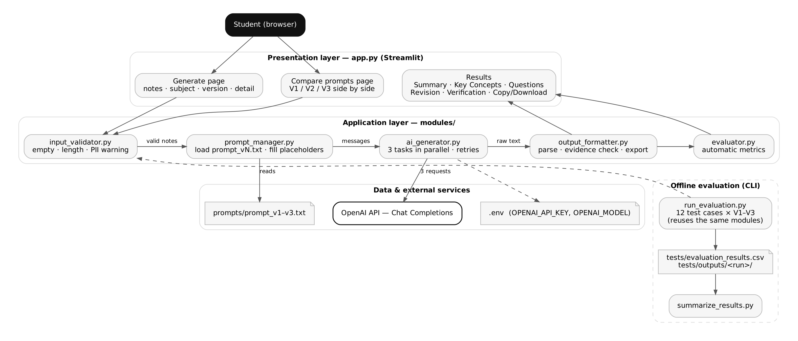
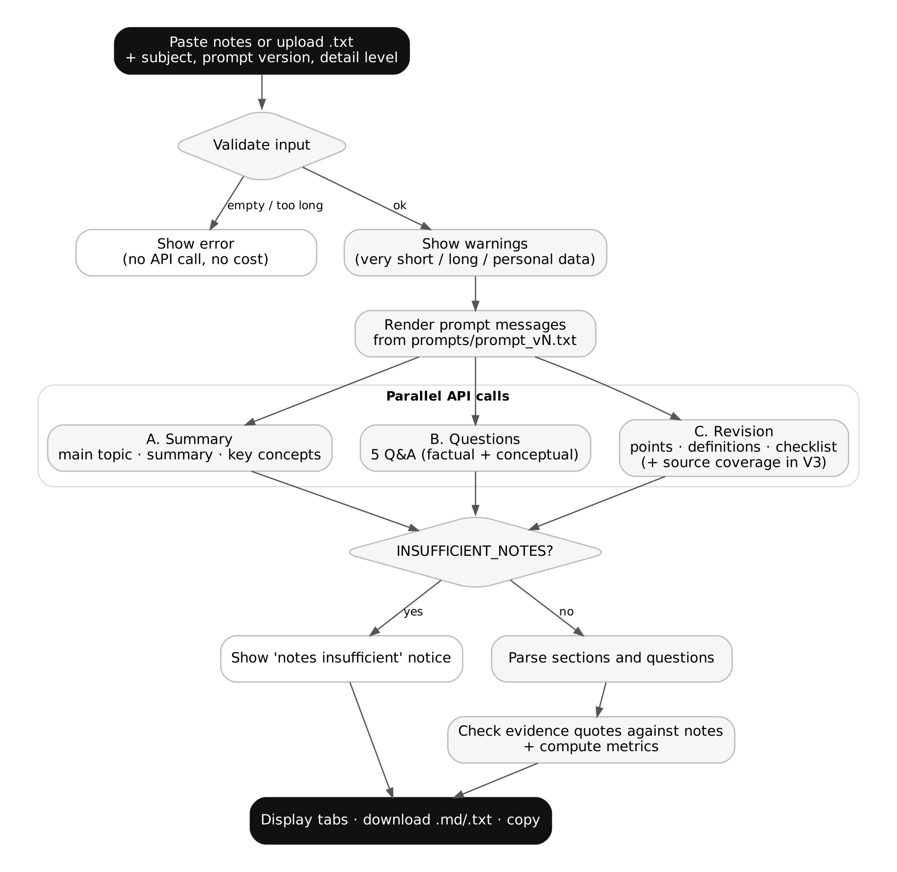

# StudyMate — Architecture

## System architecture



StudyMate has three layers plus an offline evaluation tool:

| Layer | Files | Responsibility |
|---|---|---|
| Presentation | `app.py`, `.streamlit/config.toml` | Streamlit UI: Generate, Compare prompts, About pages; results tabs; download and copy; custom black/white/grey styling |
| Application | `modules/*.py` | Validation, prompt loading, API calls, parsing, verification, metrics |
| Data / external | `prompts/*.txt`, `.env`, OpenAI API | Versioned prompt files, secrets, the language model |
| Evaluation | `run_evaluation.py`, `summarize_results.py`, `tests/` | Runs test cases against prompt versions and records the evidence |

## Request workflow



1. The student pastes notes or uploads a `.txt` file, then picks a subject, a prompt version and a detail level.
2. `input_validator.validate_notes` normalises whitespace and **rejects** empty or over-length input (40,000 characters) before any API call. It **warns** about very short notes, symbol-heavy text and apparent emails or phone numbers.
3. `prompt_manager.render_messages` loads `prompts/prompt_vN.txt`, picks the task section and fills `{{PLACEHOLDERS}}` (notes, subject, detail-level limits).
4. `ai_generator.generate_study_pack` sends the three task prompts (**A. Summary, B. Questions, C. Revision**) to the OpenAI Chat Completions API **in parallel** (thread pool). Each call has retries and error handling.
5. `output_formatter.build_study_pack` splits the Markdown on the headings the prompt asked for, parses questions, detects `INSUFFICIENT_NOTES`, and falls back to raw text when the output has no structure (V1).
6. `output_formatter.verify_evidence` and `evaluator.evaluate_pack` check evidence quotes against the notes and compute metrics.
7. The UI shows the tabs, a disclaimer, the Verification tab, Markdown/TXT download and a copy box.

## Module reference

| Module | Key functions | Notes |
|---|---|---|
| `input_validator.py` | `validate_notes`, `validate_subject`, `decode_upload` | Returns `ValidationResult(ok, text, errors, warnings, stats)`; errors block, warnings inform |
| `prompt_manager.py` | `list_versions`, `load_version`, `render_messages`, `DETAIL_LEVELS` | Any `prompts/prompt_vN.txt` with `=== SYSTEM/SUMMARY/QUESTIONS/REVISION ===` sections is picked up automatically |
| `ai_generator.py` | `generate_study_pack`, `call_model`, `GenerationSettings.from_env` | Parallel tasks; retries transient errors; drops parameters the model rejects (`temperature`, `reasoning_effort`) and records it |
| `output_formatter.py` | `build_study_pack`, `parse_questions`, `verify_evidence`, `to_markdown` | Structured `StudyPack` dataclass; the evidence check ignores case and punctuation |
| `evaluator.py` | `evaluate_pack`, `novel_term_ratio`, `duplicate_bullet_pairs` | Proxy metrics; see `testing_methodology.md` for limits |

## Key design decisions (viva notes)

1. **Three separate prompt tasks instead of one big prompt.** Each task has its own focused instructions and output format, so it is easier to engineer, test and debug one at a time. A failure in one task doesn't lose the others. The calls run in parallel, so the time cost is roughly that of the slowest task. The trade-off is that the system prompt and notes are sent three times, which uses more input tokens.
2. **Prompts in text files, not in Python.** Prompt engineering is the subject of the project, so prompts are first-class artefacts: readable, diff-able in Git and swappable without code changes. The comparison page and the evaluation runner discover versions automatically.
3. **Markdown with fixed headings rather than JSON output.** Markdown is readable even when parsing fails, which matters for showing V1's unstructured output. It also works across models. JSON mode would make parsing stricter but hides the raw text and makes the baseline comparison less fair.
4. **Grounding that can be checked locally.** V3 asks for short verbatim evidence quotes, which the app checks with string matching against the notes. This gives a transparent, model-independent signal. It shows that a claim is anchored, not that it is correct, and the UI says so.
5. **Validation before the API.** Empty and over-length inputs never reach the model, so they cost nothing and give instant feedback.
6. **Model-agnostic API wrapper.** OpenAI's newer reasoning models reject `temperature`, and older ones reject `reasoning_effort`. Instead of hard-coding model names, the wrapper drops a rejected optional parameter, retries and logs it. The model can be changed in `.env` without code changes.
7. **Secrets never in code.** The key comes from `.env` (git-ignored), Streamlit secrets, or a session-only sidebar field. `.env.example` documents the variables.

## Folder structure

```
StudyMate/
├── app.py                     Streamlit UI
├── run_evaluation.py          experiment runner (CLI)
├── summarize_results.py       report tables + chart from the CSV
├── requirements.txt
├── .env.example  .gitignore  .streamlit/config.toml
├── prompts/                   prompt_v1.txt · prompt_v2.txt · prompt_v3.txt
├── modules/                   input_validator · prompt_manager · ai_generator · output_formatter · evaluator
├── tests/
│   ├── inputs/                12 test inputs (tc01…tc12)
│   ├── outputs/               raw model outputs per run (created by the runner)
│   ├── test_cases.json/.md    test registry (expected behaviour + checks)
│   ├── evaluation_results.csv results (written only by the runner)
│   └── test_modules.py        41 unit/integration tests
├── docs/                      architecture · prompt_iteration_log · testing_methodology · demo_script · report drafts · diagrams/
└── screenshots/               real screenshots of the running app (add your own)
```

Two additions to the suggested structure: `modules/evaluator.py` keeps the metrics separate from formatting, and the two CLI scripts at the root make the experiments reproducible.
